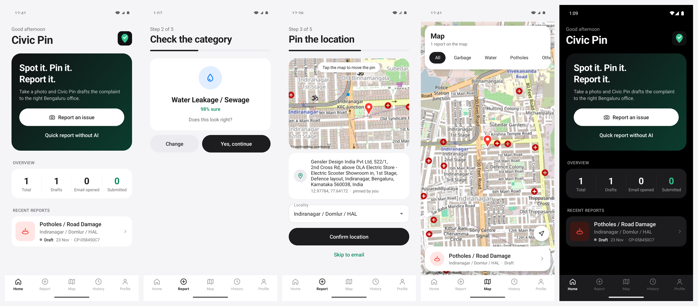

# Civic Pin

Android app for reporting civic problems in Bengaluru. Take a photo, the app works out
what the problem is, you pin the spot on the map, and it drafts a complaint email to the
right department.



## What is inside

- **Our own image classifier.** A small CNN we designed and trained from scratch (random
  starting weights, no pretrained network). It sorts photos into Garbage, Water leak / sewer,
  Potholes and Others. Accuracy on 755 test photos it never saw in training: 94.8%.
  Details: [docs/ML_MODEL.md](docs/ML_MODEL.md) and the
  [full report (PDF)](docs/CivicPin_ML_Model_Report.pdf). Training code is in [ml/](ml).
- **OpenStreetMap** for the map (osmdroid). No API key or account needed.
- **Works offline for classification.** The model runs on the phone with TensorFlow Lite.
- English and Kannada, light and dark mode.

## Build

Open the folder in Android Studio and press Run, or from a terminal:

```bash
sh ./gradlew testDebugUnitTest app:assembleDebug
```

More in [docs/SETUP.md](docs/SETUP.md).

## Credits

Training photos come from two public research datasets, both CC BY 4.0: QR4Change
(Mendeley Data) and the Urban Flood Image Dataset (HydroShare). Full citations are in the
PDF report. The photos are used for training only and are not part of the app.
Map data © OpenStreetMap contributors.
